# Jarkom-Modul-4-2026-K-22

**Anggota Kelompok**
| Nama                   | NRP        |
| ---------------------- | ---------- |
| Muhamad Sabilil Haq    | 5027251041 |
| M. Faris Roisul Azhar    | 5027251048 |

## Laporan Praktikum

**Kelompok:** K22\
**Prefix IP:** `192.222.x.x`\
**Daftar Isi**\

- [1. Ketentuan Soal](#1-ketentuan-soal)
- [2. Topologi GNS3](#2-topologi-gns3)
- [3. Perhitungan Kebutuhan IP](#3-perhitungan-kebutuhan-ip)
- [4. Perhitungan CIDR](#4-perhitungan-cidr)
- [5. Konfigurasi pada GNS3](#5-konfigurasi-pada-gns3)
- [6. Routing Statis dengan Rute Agregat](#6-routing-statis-dengan-rute-agregat)
- [7. Pengujian](#7-pengujian)

------------------------------------------------------------------------

## 1. Ketentuan Soal

Ketentuan utama pada soal yang menjadi dasar pengerjaan adalah sebagai berikut:

> 1. Soal shift dikerjakan pada Cisco Packet Tracer dan GNS3 menggunakan metode perhitungan CLASSLESS yang berbeda. Bila di CPT menggunakan VLSM, maka di GNS3 menggunakan CIDR atau sebaliknya.
>
> 3. Pembagian IP menggunakan Prefix IP yang telah ditentukan pada modul pengenalan.
>
> 4. Pembagian IP dan routing harus SEEFISIEN MUNGKIN.
>
> 5. Seluruh node yang ada pada topologi harus dapat TERKONEKSI satu sama lain dan dapat melakukan PING ke node lainnya yang ada di topologi.
>
> 7. Router Cyberia merupakan satu-satunya router yang terhubung ke NAT/Cloud. Jumlah host pada tiap node sudah tertera pada gambar topologi.
>
> 8. Jumlah IP setiap subnet dihitung dari jumlah host ditambah jumlah interface router yang berada pada subnet tersebut.

Pada bagian ini, topologi dikerjakan di **GNS3** menggunakan metode **CIDR** dengan routing **statis**. Berkas yang digunakan adalah:

| Berkas | Keterangan |
|---|---|
| [K-22-MODUL-4.gns3project](GNS3/K-22-MODUL-4.gns3project) | Project GNS3 yang didemokan |
| [Sps_k22.xlsx](VLSM/Sps_k22.xlsx) | Spreadsheet perhitungan; bagian CIDR berada pada sheet *Rute*, *Penggabungan - CIDR*, dan *Pembagian IP - CIDR* |
| [assets/pohon-cidr.png](assets/pohon-cidr.png) | Gambar pohon pembagian IP CIDR |
| [GNS3/config](GNS3/config) | Salinan `/etc/network/interfaces` setiap node |

### 1.1. Glosarium Entitas

- **Cyberia**: router gerbang, satu-satunya router yang terhubung ke **NAT1**.
- **Wired**: router *hub* yang bercabang ke Navi, Tachibana, dan segmen bersama Switch2.
- **Navi**: router cabang dengan tiga LAN, yaitu Switch6, Switch7, dan Switch8.
- **Psyche, Copland, Schumann**: tiga router yang berbagi segmen Switch2 bersama Wired.
- **Accela**: router di bawah Schumann yang melayani LAN Switch5.
- **Tachibana → Deus → Protocol7 → Knights → Phantoma → Shibuya**: rantai router menuju lapisan terdalam, tempat node Lain berada.
- **A1–A25**: nama subnet hasil pembagian, mengikuti template spreadsheet.
- **B1–I1**: nama blok hasil penggabungan CIDR.

------------------------------------------------------------------------

## 2. Topologi GNS3

Topologi terdiri dari 13 router, 13 switch, 25 node, dan satu NAT. Seluruh router dan node (38 perangkat) menggunakan image Docker `ardhptr21/debinet:latest`, dan Cyberia terhubung ke node **NAT1** melalui `eth0`. Diagram berikut menunjukkan hubungan antarrouter beserta nama subnet di setiap link dan LAN.

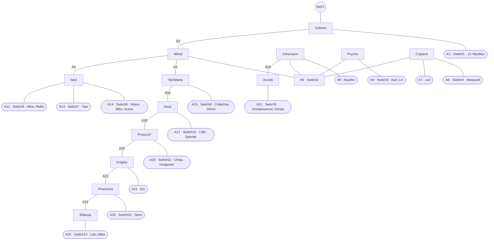

**Gambar 2.1 --- Topologi GNS3 beserta label interface**

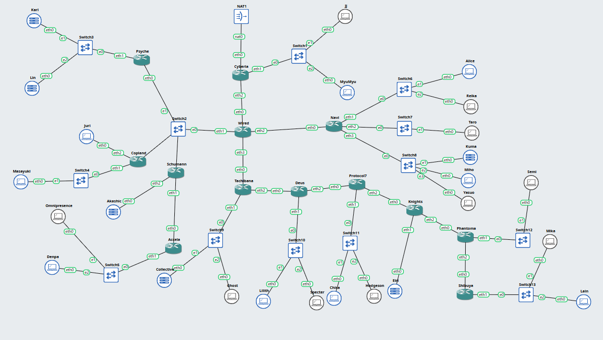

------------------------------------------------------------------------

## 3. Perhitungan Kebutuhan IP

Langkah pertama adalah menghitung jumlah IP yang dibutuhkan setiap subnet. Aturan yang kami gunakan adalah:

1. **Jumlah IP** subnet = jumlah host + jumlah interface router pada subnet tersebut (ketentuan soal nomor 8).
2. **Netmask** = blok terkecil yang memuat jumlah IP + 2. Dua alamat tambahan adalah *network ID* dan *broadcast*, yang dihitung satu kali per subnet, bukan per node.
3. Link antarrouter tanpa host membutuhkan 2 IP sehingga menggunakan `/30`, sedangkan segmen Switch2 (Wired, Psyche, Copland, Schumann) membutuhkan 4 IP sehingga menggunakan `/29`.

Contoh perhitungan subnet A1 (Cyberia > Switch1 > JJ, MyuMyu): JJ memiliki 95 host dan MyuMyu 30 host, ditambah 1 interface Cyberia, sehingga jumlah IP adalah **126**. Karena 126 + 2 = 128, subnet A1 menggunakan blok 128 alamat atau **/25**.

| Subnet | Rute | Host | Interface router | Jumlah IP | Ukuran blok | Netmask |
|---|---|---|---|---|---|---|
| A1 | Cyberia > Switch1 > JJ, MyuMyu | 95 + 30 = 125 | 1 | 126 | 128 | /25 |
| A2 | Cyberia > Wired | 0 | 2 | 2 | 4 | /30 |
| A3 | Wired > Navi | 0 | 2 | 2 | 4 | /30 |
| A4 | Wired > Tachibana | 0 | 2 | 2 | 4 | /30 |
| A5 | Wired > Switch2 > Psyche, Copland, Schumann | 0 | 4 | 4 | 8 | /29 |
| A6 | Psyche > Switch3 > Karl, Lin | 700 + 180 = 880 | 1 | 881 | 1024 | /22 |
| A7 | Copland > Juri | 31 | 1 | 32 | 64 | /26 |
| A8 | Copland > Switch4 > Masayuki | 300 | 1 | 301 | 512 | /23 |
| A9 | Schumann > Akashic | 3 | 1 | 4 | 8 | /29 |
| A10 | Schumann > Accela | 0 | 2 | 2 | 4 | /30 |
| A11 | Accela > Switch5 > Omnipresence, Denpa | 510 + 3 = 513 | 1 | 514 | 1024 | /22 |
| A12 | Navi > Switch6 > Alice, Reika | 208 + 45 = 253 | 1 | 254 | 256 | /24 |
| A13 | Navi > Switch7 > Taro | 57 | 1 | 58 | 64 | /26 |
| A14 | Navi > Switch8 > Yasuo, Miho, Kuma | 120 + 18 + 4 = 142 | 1 | 143 | 256 | /24 |
| A15 | Tachibana > Switch9 > Collective, Ghost | 260 + 6 = 266 | 1 | 267 | 512 | /23 |
| A16 | Tachibana > Deus | 0 | 2 | 2 | 4 | /30 |
| A17 | Deus > Switch10 > Lilith, Specter | 77 + 21 = 98 | 1 | 99 | 128 | /25 |
| A18 | Deus > Protocol7 | 0 | 2 | 2 | 4 | /30 |
| A19 | Protocol7 > Switch11 > Chisa, Hodgeson | 23 + 9 = 32 | 1 | 33 | 64 | /26 |
| A20 | Protocol7 > Knights | 0 | 2 | 2 | 4 | /30 |
| A21 | Knights > Eiri | 2 | 1 | 3 | 8 | /29 |
| A22 | Knights > Phantoma | 0 | 2 | 2 | 4 | /30 |
| A23 | Phantoma > Switch12 > Semi | 14 | 1 | 15 | 32 | /27 |
| A24 | Phantoma > Shibuya | 0 | 2 | 2 | 4 | /30 |
| A25 | Shibuya > Switch13 > Lain, Mika | 57 + 4 = 61 | 1 | 62 | 64 | /26 |
| **Total** | | | | **2814** | **4188** | **/19** |

Total ukuran blok seluruh subnet adalah **4188** alamat. Nilai ini melebihi kapasitas `/20` (4.096 alamat), sehingga blok induk terkecil yang dapat menampung seluruh subnet adalah **`192.222.0.0/19`** (8.192 alamat, netmask `255.255.224.0`).

------------------------------------------------------------------------

## 4. Perhitungan CIDR

### 4.1. Langkah Penggabungan

CIDR membangun blok induk dari bawah ke atas dengan cara menggabungkan subnet secara berpasangan. Aturan yang digunakan disini adalah:

1. Dua subnet yang bertetangga pada topologi digabung menjadi satu blok. Netmask hasil gabungan adalah satu tingkat di atas subnet yang lebih besar (prefix terkecil dikurangi 1).
2. Subnet yang lebih besar menempati alamat bawah. Bila ukurannya sama, subnet dengan nomor lebih kecil ditempatkan di bawah.
3. Penggabungan dimulai dari subnet kecil yang paling jauh dari NAT (link `/30` dan LAN kecil), lalu naik ke arah Cyberia. Menggabungkan link `/30` langsung ke blok besar akan menggandakan ukuran blok di setiap tingkat sehingga blok induk menjadi terlalu besar.
4. Setelah blok induk diperoleh, alamat dibagikan kembali dari atas ke bawah mengikuti pohon penggabungan.

Contoh: pada tahap I, link A3 (`/30`) dan A4 (`/30`) yang sama-sama terhubung ke Wired digabung menjadi B1. Karena subnet terbesar adalah `/30`, hasil gabungannya satu tingkat di atasnya, yaitu `/29`. Pada tahap II, B1 (`/29`) digabung dengan segmen Switch2 A5 (`/29`) menjadi C1 (`/28`).

### 4.2. Tahap Penggabungan

**Tahap I**

| Subnet | Gabungan dari (1) | Netmask | Gabungan dari (2) | Netmask | Netmask akhir | Blok hasil |
|---|---|---|---|---|---|---|
| B1 | A3 | /30 | A4 | /30 | /29 | 192.222.4.128/29 |
| B2 | A8 | /23 | A7 | /26 | /22 | 192.222.20.0/22 |
| B3 | A9 | /29 | A10 | /30 | /28 | 192.222.28.0/28 |
| B4 | A12 | /24 | A14 | /24 | /23 | 192.222.0.0/23 |
| B5 | A15 | /23 | A16 | /30 | /22 | 192.222.8.0/22 |
| B6 | A17 | /25 | A18 | /30 | /24 | 192.222.14.0/24 |
| B7 | A19 | /26 | A20 | /30 | /25 | 192.222.13.0/25 |
| B8 | A21 | /29 | A22 | /30 | /28 | 192.222.12.128/28 |
| B9 | A23 | /27 | A24 | /30 | /26 | 192.222.12.0/26 |

**Tahap II**

| Subnet | Gabungan dari (1) | Netmask | Gabungan dari (2) | Netmask | Netmask akhir | Blok hasil |
|---|---|---|---|---|---|---|
| C1 | B1 | /29 | A5 | /29 | /28 | 192.222.4.128/28 |
| C2 | A6 | /22 | B2 | /22 | /21 | 192.222.16.0/21 |
| C3 | A11 | /22 | B3 | /28 | /21 | 192.222.24.0/21 |
| C4 | B4 | /23 | A13 | /26 | /22 | 192.222.0.0/22 |
| C5 | B9 | /26 | A25 | /26 | /25 | 192.222.12.0/25 |

**Tahap III**

| Subnet | Gabungan dari (1) | Netmask | Gabungan dari (2) | Netmask | Netmask akhir | Blok hasil |
|---|---|---|---|---|---|---|
| D1 | C1 | /28 | A2 | /30 | /27 | 192.222.4.128/27 |
| D2 | C2 | /21 | C3 | /21 | /20 | 192.222.16.0/20 |
| D3 | C5 | /25 | B8 | /28 | /24 | 192.222.12.0/24 |

**Tahap IV**

| Subnet | Gabungan dari (1) | Netmask | Gabungan dari (2) | Netmask | Netmask akhir | Blok hasil |
|---|---|---|---|---|---|---|
| E1 | A1 | /25 | D1 | /27 | /24 | 192.222.4.0/24 |
| E2 | D3 | /24 | B7 | /25 | /23 | 192.222.12.0/23 |

**Tahap V**

| Subnet | Gabungan dari (1) | Netmask | Gabungan dari (2) | Netmask | Netmask akhir | Blok hasil |
|---|---|---|---|---|---|---|
| F1 | C4 | /22 | E1 | /24 | /21 | 192.222.0.0/21 |
| F2 | E2 | /23 | B6 | /24 | /22 | 192.222.12.0/22 |

**Tahap VI**

| Subnet | Gabungan dari (1) | Netmask | Gabungan dari (2) | Netmask | Netmask akhir | Blok hasil |
|---|---|---|---|---|---|---|
| G1 | B5 | /22 | F2 | /22 | /21 | 192.222.8.0/21 |

**Tahap VII**

| Subnet | Gabungan dari (1) | Netmask | Gabungan dari (2) | Netmask | Netmask akhir | Blok hasil |
|---|---|---|---|---|---|---|
| H1 | F1 | /21 | G1 | /21 | /20 | 192.222.0.0/20 |

**Tahap VIII**

| Subnet | Gabungan dari (1) | Netmask | Gabungan dari (2) | Netmask | Netmask akhir | Blok hasil |
|---|---|---|---|---|---|---|
| I1 | H1 | /20 | D2 | /20 | /19 | 192.222.0.0/19 |

Hasil akhir penggabungan adalah **I1 = `192.222.0.0/19`**, sama dengan blok induk minimum yang dihitung pada bagian 3. Blok B1 sampai I1 tidak dipasang pada interface mana pun; blok tersebut hanya menandai kelompok subnet yang berada dalam satu rentang alamat dan digunakan untuk meringkas rute.

### 4.3. Hasil Pembagian IP

| Subnet | Network ID | Netmask | Broadcast | Range IP |
|---|---|---|---|---|
| A1 | 192.222.4.0 | 255.255.255.128 (/25) | 192.222.4.127 | 192.222.4.1 - 192.222.4.126 |
| A2 | 192.222.4.144 | 255.255.255.252 (/30) | 192.222.4.147 | 192.222.4.145 - 192.222.4.146 |
| A3 | 192.222.4.128 | 255.255.255.252 (/30) | 192.222.4.131 | 192.222.4.129 - 192.222.4.130 |
| A4 | 192.222.4.132 | 255.255.255.252 (/30) | 192.222.4.135 | 192.222.4.133 - 192.222.4.134 |
| A5 | 192.222.4.136 | 255.255.255.248 (/29) | 192.222.4.143 | 192.222.4.137 - 192.222.4.142 |
| A6 | 192.222.16.0 | 255.255.252.0 (/22) | 192.222.19.255 | 192.222.16.1 - 192.222.19.254 |
| A7 | 192.222.22.0 | 255.255.255.192 (/26) | 192.222.22.63 | 192.222.22.1 - 192.222.22.62 |
| A8 | 192.222.20.0 | 255.255.254.0 (/23) | 192.222.21.255 | 192.222.20.1 - 192.222.21.254 |
| A9 | 192.222.28.0 | 255.255.255.248 (/29) | 192.222.28.7 | 192.222.28.1 - 192.222.28.6 |
| A10 | 192.222.28.8 | 255.255.255.252 (/30) | 192.222.28.11 | 192.222.28.9 - 192.222.28.10 |
| A11 | 192.222.24.0 | 255.255.252.0 (/22) | 192.222.27.255 | 192.222.24.1 - 192.222.27.254 |
| A12 | 192.222.0.0 | 255.255.255.0 (/24) | 192.222.0.255 | 192.222.0.1 - 192.222.0.254 |
| A13 | 192.222.2.0 | 255.255.255.192 (/26) | 192.222.2.63 | 192.222.2.1 - 192.222.2.62 |
| A14 | 192.222.1.0 | 255.255.255.0 (/24) | 192.222.1.255 | 192.222.1.1 - 192.222.1.254 |
| A15 | 192.222.8.0 | 255.255.254.0 (/23) | 192.222.9.255 | 192.222.8.1 - 192.222.9.254 |
| A16 | 192.222.10.0 | 255.255.255.252 (/30) | 192.222.10.3 | 192.222.10.1 - 192.222.10.2 |
| A17 | 192.222.14.0 | 255.255.255.128 (/25) | 192.222.14.127 | 192.222.14.1 - 192.222.14.126 |
| A18 | 192.222.14.128 | 255.255.255.252 (/30) | 192.222.14.131 | 192.222.14.129 - 192.222.14.130 |
| A19 | 192.222.13.0 | 255.255.255.192 (/26) | 192.222.13.63 | 192.222.13.1 - 192.222.13.62 |
| A20 | 192.222.13.64 | 255.255.255.252 (/30) | 192.222.13.67 | 192.222.13.65 - 192.222.13.66 |
| A21 | 192.222.12.128 | 255.255.255.248 (/29) | 192.222.12.135 | 192.222.12.129 - 192.222.12.134 |
| A22 | 192.222.12.136 | 255.255.255.252 (/30) | 192.222.12.139 | 192.222.12.137 - 192.222.12.138 |
| A23 | 192.222.12.0 | 255.255.255.224 (/27) | 192.222.12.31 | 192.222.12.1 - 192.222.12.30 |
| A24 | 192.222.12.32 | 255.255.255.252 (/30) | 192.222.12.35 | 192.222.12.33 - 192.222.12.34 |
| A25 | 192.222.12.64 | 255.255.255.192 (/26) | 192.222.12.127 | 192.222.12.65 - 192.222.12.126 |

Alamat induk yang digunakan adalah `192.222.28.11` (broadcast A10), masih berada di dalam blok induk `192.222.0.0/19` yang berakhir pada `192.222.31.255`. Tidak ada subnet yang saling tumpang tindih.

### 4.4. Pohon Pembagian IP

Anak di sebelah atas menempati alamat yang lebih rendah. Kotak kuning menandai blok yang digunakan sebagai **satu rute agregat** oleh router di atasnya.

**Gambar 4.1 --- Pohon pembagian IP CIDR**

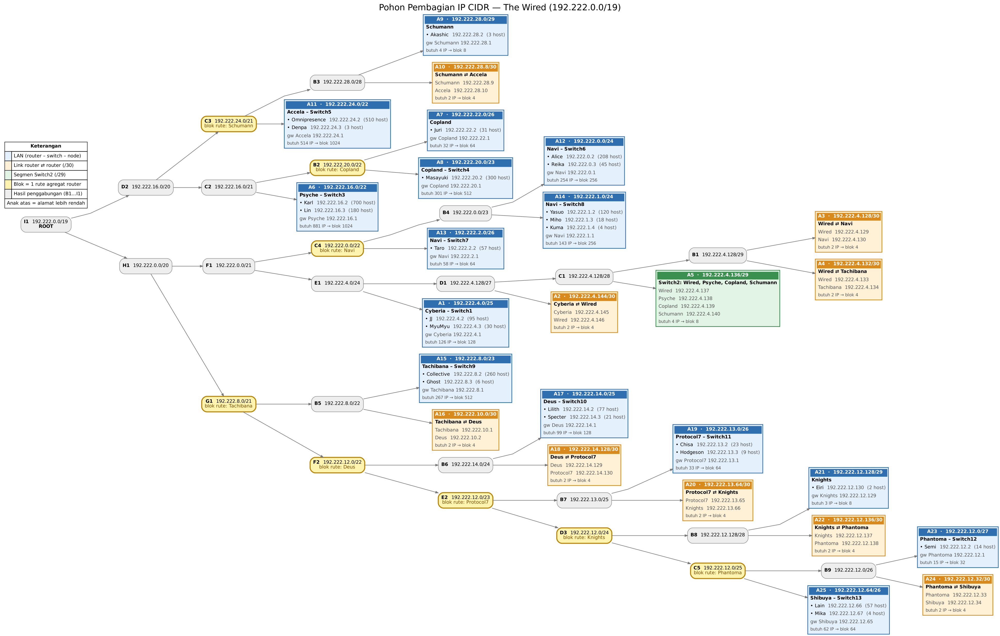

Versi SVG: [assets/pohon-cidr.svg](assets/pohon-cidr.svg)

Untuk memperlihatkan hasil penggabungan pada topologi, kami juga melingkari setiap subnet dan blok gabungan langsung di atas topologi GNS3. Gambar ringkasan memuat seluruh lingkaran sekaligus, sedangkan gambar per tahap memperlihatkan satu tahap penggabungan dengan garis tebal sebagai hasil gabungan dan garis tipis sebagai subnet yang digabung.

**Gambar 4.2 --- Topologi GNS3 dengan lingkaran seluruh subnet dan blok gabungan**

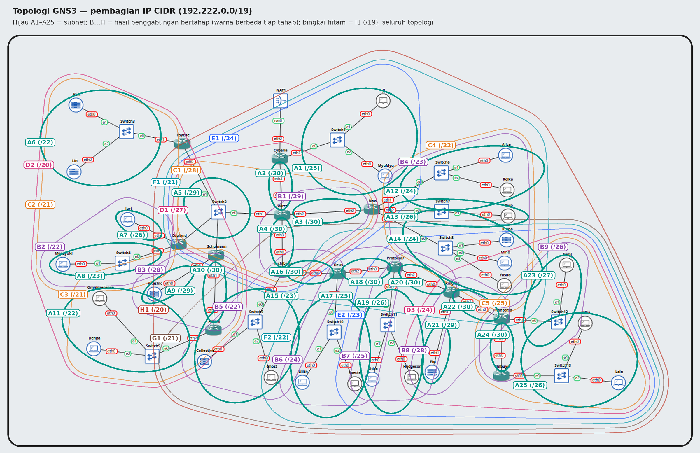

**Gambar 4.3 --- Penggabungan tahap I (B1, B2, B3, B4, B5, B6, B7, B8, B9)**

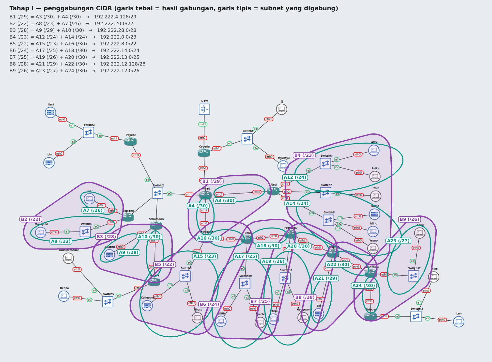

**Gambar 4.4 --- Penggabungan tahap II (C1, C2, C3, C4, C5)**

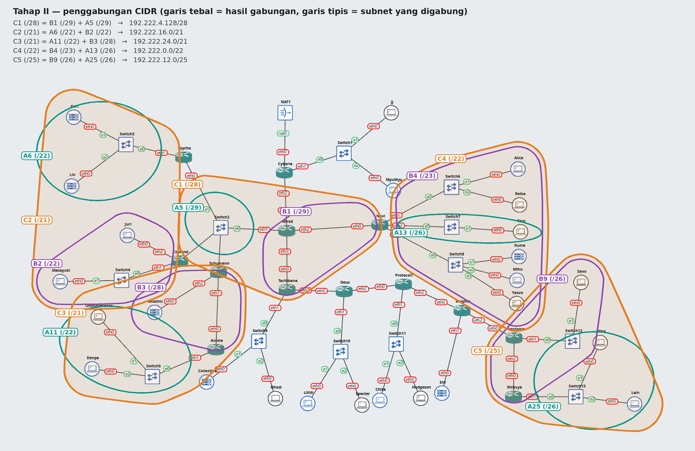

**Gambar 4.5 --- Penggabungan tahap III (D1, D2, D3)**

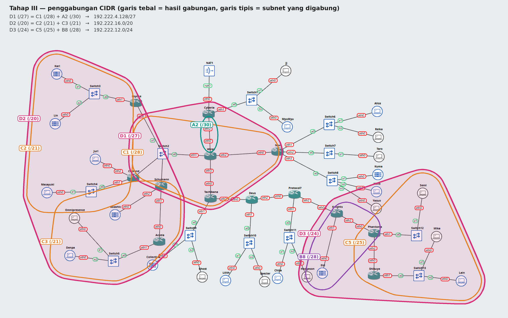

**Gambar 4.6 --- Penggabungan tahap IV (E1, E2)**

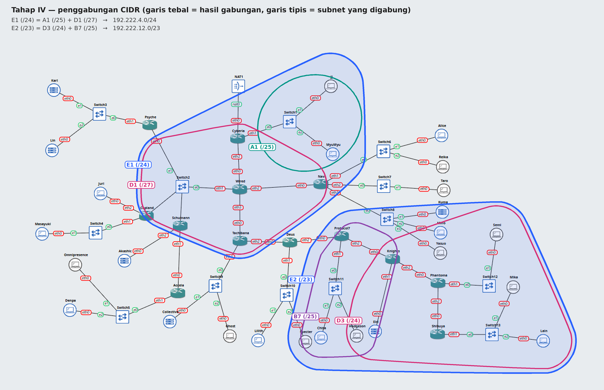

**Gambar 4.7 --- Penggabungan tahap V (F1, F2)**

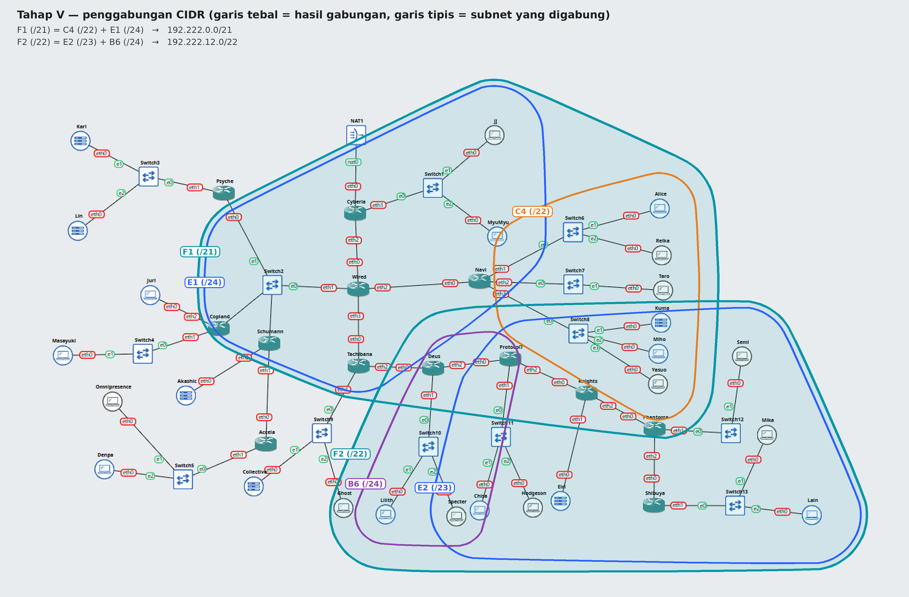

**Gambar 4.8 --- Penggabungan tahap VI (G1)**

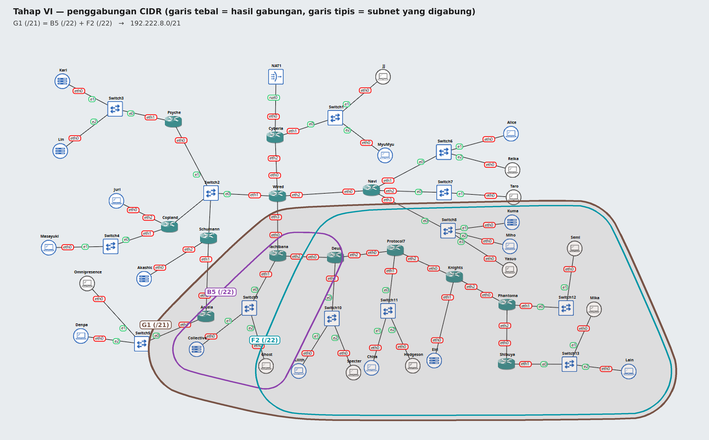

**Gambar 4.9 --- Penggabungan tahap VII (H1)**

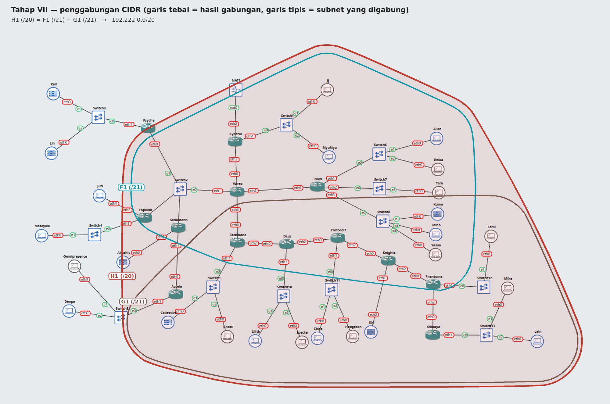

**Gambar 4.10 --- Penggabungan tahap VIII (I1)**

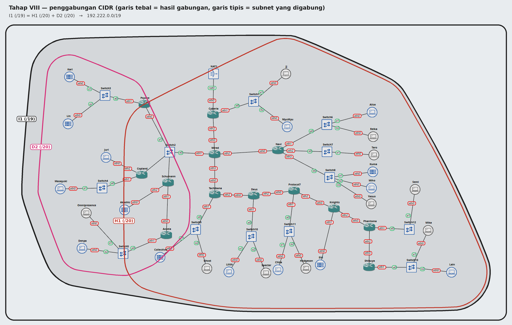

------------------------------------------------------------------------

## 5. Konfigurasi pada GNS3

### 5.1. Aturan Pemberian Alamat

- **LAN**: gateway (interface router) menggunakan alamat host pertama (`NID + 1`), sedangkan node menggunakan alamat setelahnya secara berurutan.
- **Link antarrouter `/30`**: router sisi atas (lebih dekat ke Cyberia) menggunakan alamat host pertama, dan router sisi bawah menggunakan alamat host kedua.
- **Segmen Switch2 (A5)**: Wired `.137`, Psyche `.138`, Copland `.139`, dan Schumann `.140`.
- **Cyberia ke NAT**: tidak disubnet, karena alamat `eth0` Cyberia diperoleh dari DHCP NAT GNS3.

Konfigurasi diterapkan melalui klik kanan node → **Configure** → **General settings** → **Edit network configuration**, sehingga isi `/etc/network/interfaces` tersimpan di dalam project dan otomatis dipasang setiap kali node dijalankan. Rute statis ditulis dengan `up ip route add ...`, dan router yang meneruskan paket memakai `up sysctl -w net.ipv4.ip_forward=1`. Cyberia juga memasang aturan `MASQUERADE` pada `eth0` agar seluruh jaringan dapat keluar melalui NAT.

### 5.2. Peta Interface Router

| Router | ethN | Terhubung ke | Subnet | IP/prefix |
|---|---|---|---|---|
| Cyberia | eth0 | NAT1 | (DHCP dari NAT) | DHCP |
| Cyberia | eth1 | Switch1 | A1 (192.222.4.0/25) | 192.222.4.1/25 |
| Cyberia | eth2 | Wired | A2 (192.222.4.144/30) | 192.222.4.145/30 |
| Wired | eth0 | Cyberia | A2 (192.222.4.144/30) | 192.222.4.146/30 |
| Wired | eth1 | Switch2 | A5 (192.222.4.136/29) | 192.222.4.137/29 |
| Wired | eth2 | Navi | A3 (192.222.4.128/30) | 192.222.4.129/30 |
| Wired | eth3 | Tachibana | A4 (192.222.4.132/30) | 192.222.4.133/30 |
| Navi | eth0 | Wired | A3 (192.222.4.128/30) | 192.222.4.130/30 |
| Navi | eth1 | Switch6 | A12 (192.222.0.0/24) | 192.222.0.1/24 |
| Navi | eth2 | Switch7 | A13 (192.222.2.0/26) | 192.222.2.1/26 |
| Navi | eth3 | Switch8 | A14 (192.222.1.0/24) | 192.222.1.1/24 |
| Tachibana | eth0 | Wired | A4 (192.222.4.132/30) | 192.222.4.134/30 |
| Tachibana | eth1 | Switch9 | A15 (192.222.8.0/23) | 192.222.8.1/23 |
| Tachibana | eth2 | Deus | A16 (192.222.10.0/30) | 192.222.10.1/30 |
| Psyche | eth0 | Switch2 | A5 (192.222.4.136/29) | 192.222.4.138/29 |
| Psyche | eth1 | Switch3 | A6 (192.222.16.0/22) | 192.222.16.1/22 |
| Copland | eth0 | Switch2 | A5 (192.222.4.136/29) | 192.222.4.139/29 |
| Copland | eth1 | Switch4 | A8 (192.222.20.0/23) | 192.222.20.1/23 |
| Copland | eth2 | Juri | A7 (192.222.22.0/26) | 192.222.22.1/26 |
| Schumann | eth0 | Switch2 | A5 (192.222.4.136/29) | 192.222.4.140/29 |
| Schumann | eth1 | Accela | A10 (192.222.28.8/30) | 192.222.28.9/30 |
| Schumann | eth2 | Akashic | A9 (192.222.28.0/29) | 192.222.28.1/29 |
| Accela | eth0 | Schumann | A10 (192.222.28.8/30) | 192.222.28.10/30 |
| Accela | eth1 | Switch5 | A11 (192.222.24.0/22) | 192.222.24.1/22 |
| Deus | eth0 | Tachibana | A16 (192.222.10.0/30) | 192.222.10.2/30 |
| Deus | eth1 | Switch10 | A17 (192.222.14.0/25) | 192.222.14.1/25 |
| Deus | eth2 | Protocol7 | A18 (192.222.14.128/30) | 192.222.14.129/30 |
| Protocol7 | eth0 | Deus | A18 (192.222.14.128/30) | 192.222.14.130/30 |
| Protocol7 | eth1 | Switch11 | A19 (192.222.13.0/26) | 192.222.13.1/26 |
| Protocol7 | eth2 | Knights | A20 (192.222.13.64/30) | 192.222.13.65/30 |
| Knights | eth0 | Protocol7 | A20 (192.222.13.64/30) | 192.222.13.66/30 |
| Knights | eth1 | Eiri | A21 (192.222.12.128/29) | 192.222.12.129/29 |
| Knights | eth2 | Phantoma | A22 (192.222.12.136/30) | 192.222.12.137/30 |
| Phantoma | eth0 | Knights | A22 (192.222.12.136/30) | 192.222.12.138/30 |
| Phantoma | eth1 | Switch12 | A23 (192.222.12.0/27) | 192.222.12.1/27 |
| Phantoma | eth2 | Shibuya | A24 (192.222.12.32/30) | 192.222.12.33/30 |
| Shibuya | eth0 | Phantoma | A24 (192.222.12.32/30) | 192.222.12.34/30 |
| Shibuya | eth1 | Switch13 | A25 (192.222.12.64/26) | 192.222.12.65/26 |

### 5.3. Konfigurasi Router

Berikut konfigurasi `/etc/network/interfaces` pada setiap router. Salinan seluruh konfigurasi juga tersimpan pada folder [GNS3/config](GNS3/config).

- Cyberia
```
auto eth0
iface eth0 inet dhcp
    up sysctl -w net.ipv4.ip_forward=1
    up iptables -t nat -A POSTROUTING -o eth0 -j MASQUERADE

auto eth1
iface eth1 inet static
    address 192.222.4.1
    netmask 255.255.255.128

auto eth2
iface eth2 inet static
    address 192.222.4.145
    netmask 255.255.255.252
    up ip route add 192.222.0.0/19 via 192.222.4.146
```
- Wired
```
auto eth0
iface eth0 inet static
    address 192.222.4.146
    netmask 255.255.255.252
    gateway 192.222.4.145
    up sysctl -w net.ipv4.ip_forward=1

auto eth1
iface eth1 inet static
    address 192.222.4.137
    netmask 255.255.255.248
    up ip route add 192.222.16.0/22 via 192.222.4.138
    up ip route add 192.222.20.0/22 via 192.222.4.139
    up ip route add 192.222.24.0/21 via 192.222.4.140

auto eth2
iface eth2 inet static
    address 192.222.4.129
    netmask 255.255.255.252
    up ip route add 192.222.0.0/22 via 192.222.4.130

auto eth3
iface eth3 inet static
    address 192.222.4.133
    netmask 255.255.255.252
    up ip route add 192.222.8.0/21 via 192.222.4.134
```
- Navi
```
auto eth0
iface eth0 inet static
    address 192.222.4.130
    netmask 255.255.255.252
    gateway 192.222.4.129
    up sysctl -w net.ipv4.ip_forward=1

auto eth1
iface eth1 inet static
    address 192.222.0.1
    netmask 255.255.255.0

auto eth2
iface eth2 inet static
    address 192.222.2.1
    netmask 255.255.255.192

auto eth3
iface eth3 inet static
    address 192.222.1.1
    netmask 255.255.255.0
```
- Tachibana
```
auto eth0
iface eth0 inet static
    address 192.222.4.134
    netmask 255.255.255.252
    gateway 192.222.4.133
    up sysctl -w net.ipv4.ip_forward=1

auto eth1
iface eth1 inet static
    address 192.222.8.1
    netmask 255.255.254.0

auto eth2
iface eth2 inet static
    address 192.222.10.1
    netmask 255.255.255.252
    up ip route add 192.222.12.0/22 via 192.222.10.2
```
- Psyche
```
auto eth0
iface eth0 inet static
    address 192.222.4.138
    netmask 255.255.255.248
    gateway 192.222.4.137
    up sysctl -w net.ipv4.ip_forward=1

auto eth1
iface eth1 inet static
    address 192.222.16.1
    netmask 255.255.252.0
```
- Copland
```
auto eth0
iface eth0 inet static
    address 192.222.4.139
    netmask 255.255.255.248
    gateway 192.222.4.137
    up sysctl -w net.ipv4.ip_forward=1

auto eth1
iface eth1 inet static
    address 192.222.20.1
    netmask 255.255.254.0

auto eth2
iface eth2 inet static
    address 192.222.22.1
    netmask 255.255.255.192
```
- Schumann
```
auto eth0
iface eth0 inet static
    address 192.222.4.140
    netmask 255.255.255.248
    gateway 192.222.4.137
    up sysctl -w net.ipv4.ip_forward=1

auto eth1
iface eth1 inet static
    address 192.222.28.9
    netmask 255.255.255.252
    up ip route add 192.222.24.0/22 via 192.222.28.10

auto eth2
iface eth2 inet static
    address 192.222.28.1
    netmask 255.255.255.248
```
- Accela
```
auto eth0
iface eth0 inet static
    address 192.222.28.10
    netmask 255.255.255.252
    gateway 192.222.28.9
    up sysctl -w net.ipv4.ip_forward=1

auto eth1
iface eth1 inet static
    address 192.222.24.1
    netmask 255.255.252.0
```
- Deus
```
auto eth0
iface eth0 inet static
    address 192.222.10.2
    netmask 255.255.255.252
    gateway 192.222.10.1
    up sysctl -w net.ipv4.ip_forward=1

auto eth1
iface eth1 inet static
    address 192.222.14.1
    netmask 255.255.255.128

auto eth2
iface eth2 inet static
    address 192.222.14.129
    netmask 255.255.255.252
    up ip route add 192.222.12.0/23 via 192.222.14.130
```
- Protocol7
```
auto eth0
iface eth0 inet static
    address 192.222.14.130
    netmask 255.255.255.252
    gateway 192.222.14.129
    up sysctl -w net.ipv4.ip_forward=1

auto eth1
iface eth1 inet static
    address 192.222.13.1
    netmask 255.255.255.192

auto eth2
iface eth2 inet static
    address 192.222.13.65
    netmask 255.255.255.252
    up ip route add 192.222.12.0/24 via 192.222.13.66
```
- Knights
```
auto eth0
iface eth0 inet static
    address 192.222.13.66
    netmask 255.255.255.252
    gateway 192.222.13.65
    up sysctl -w net.ipv4.ip_forward=1

auto eth1
iface eth1 inet static
    address 192.222.12.129
    netmask 255.255.255.248

auto eth2
iface eth2 inet static
    address 192.222.12.137
    netmask 255.255.255.252
    up ip route add 192.222.12.0/25 via 192.222.12.138
```
- Phantoma
```
auto eth0
iface eth0 inet static
    address 192.222.12.138
    netmask 255.255.255.252
    gateway 192.222.12.137
    up sysctl -w net.ipv4.ip_forward=1

auto eth1
iface eth1 inet static
    address 192.222.12.1
    netmask 255.255.255.224

auto eth2
iface eth2 inet static
    address 192.222.12.33
    netmask 255.255.255.252
    up ip route add 192.222.12.64/26 via 192.222.12.34
```
- Shibuya
```
auto eth0
iface eth0 inet static
    address 192.222.12.34
    netmask 255.255.255.252
    gateway 192.222.12.33
    up sysctl -w net.ipv4.ip_forward=1

auto eth1
iface eth1 inet static
    address 192.222.12.65
    netmask 255.255.255.192
```

### 5.4. Konfigurasi Node

Seluruh node memakai pola yang sama, yaitu satu interface `eth0` dengan alamat statis, netmask subnet masing-masing, dan gateway berupa interface router pada LAN tersebut. Contoh pada Collective:

```
auto eth0
iface eth0 inet static
    address 192.222.8.2
    netmask 255.255.254.0
    gateway 192.222.8.1
```

| Node | Subnet | `address` | `netmask` | `gateway` |
|---|---|---|---|---|
| JJ | A1 | 192.222.4.2 | 255.255.255.128 | 192.222.4.1 |
| MyuMyu | A1 | 192.222.4.3 | 255.255.255.128 | 192.222.4.1 |
| Karl | A6 | 192.222.16.2 | 255.255.252.0 | 192.222.16.1 |
| Lin | A6 | 192.222.16.3 | 255.255.252.0 | 192.222.16.1 |
| Juri | A7 | 192.222.22.2 | 255.255.255.192 | 192.222.22.1 |
| Masayuki | A8 | 192.222.20.2 | 255.255.254.0 | 192.222.20.1 |
| Akashic | A9 | 192.222.28.2 | 255.255.255.248 | 192.222.28.1 |
| Omnipresence | A11 | 192.222.24.2 | 255.255.252.0 | 192.222.24.1 |
| Denpa | A11 | 192.222.24.3 | 255.255.252.0 | 192.222.24.1 |
| Alice | A12 | 192.222.0.2 | 255.255.255.0 | 192.222.0.1 |
| Reika | A12 | 192.222.0.3 | 255.255.255.0 | 192.222.0.1 |
| Taro | A13 | 192.222.2.2 | 255.255.255.192 | 192.222.2.1 |
| Yasuo | A14 | 192.222.1.2 | 255.255.255.0 | 192.222.1.1 |
| Miho | A14 | 192.222.1.3 | 255.255.255.0 | 192.222.1.1 |
| Kuma | A14 | 192.222.1.4 | 255.255.255.0 | 192.222.1.1 |
| Collective | A15 | 192.222.8.2 | 255.255.254.0 | 192.222.8.1 |
| Ghost | A15 | 192.222.8.3 | 255.255.254.0 | 192.222.8.1 |
| Lilith | A17 | 192.222.14.2 | 255.255.255.128 | 192.222.14.1 |
| Specter | A17 | 192.222.14.3 | 255.255.255.128 | 192.222.14.1 |
| Chisa | A19 | 192.222.13.2 | 255.255.255.192 | 192.222.13.1 |
| Hodgeson | A19 | 192.222.13.3 | 255.255.255.192 | 192.222.13.1 |
| Eiri | A21 | 192.222.12.130 | 255.255.255.248 | 192.222.12.129 |
| Semi | A23 | 192.222.12.2 | 255.255.255.224 | 192.222.12.1 |
| Lain | A25 | 192.222.12.66 | 255.255.255.192 | 192.222.12.65 |
| Mika | A25 | 192.222.12.67 | 255.255.255.192 | 192.222.12.65 |

------------------------------------------------------------------------

## 6. Routing Statis dengan Rute Agregat

### 6.1. Prinsip Routing

Routing pada GNS3 menggunakan rute statis yang memanfaatkan hasil penggabungan CIDR:

- Setiap router memiliki satu blok yang mencakup seluruh subnet di bawahnya. Router di atasnya cukup menuliskan **satu rute agregat** untuk setiap cabang.
- Setiap router selain Cyberia memiliki **satu default route** ke router di atasnya, sehingga tujuan di luar cabangnya dikirim ke atas.
- Cyberia hanya memiliki satu rute statis `192.222.0.0/19` ke Wired, ditambah default route dari DHCP NAT ke internet. Subnet A1 dan A2 tetap dijangkau melalui rute *connected* yang lebih spesifik (*longest prefix match*).
- Psyche, Copland, dan Schumann yang berada pada segmen Switch2 saling berkomunikasi melalui default route ke Wired, sehingga tidak memerlukan rute antarsesama.

### 6.2. Blok Cabang Setiap Router

| Router | Blok cabang (dipakai router di atasnya sebagai satu rute) | Hasil gabungan |
|---|---|---|
| Cyberia | 192.222.0.0/19 (seluruh topologi) | I1 |
| Wired | --- (tercakup rute 192.222.0.0/19 milik Cyberia) | --- |
| Navi | 192.222.0.0/22 | C4 |
| Tachibana | 192.222.8.0/21 | G1 |
| Psyche | 192.222.16.0/22 | A6 |
| Copland | 192.222.20.0/22 | B2 |
| Schumann | 192.222.24.0/21 | C3 |
| Accela | 192.222.24.0/22 | A11 |
| Deus | 192.222.12.0/22 | F2 |
| Protocol7 | 192.222.12.0/23 | E2 |
| Knights | 192.222.12.0/24 | D3 |
| Phantoma | 192.222.12.0/25 | C5 |
| Shibuya | 192.222.12.64/26 | A25 |

### 6.3. Tabel Rute Statis

| Router | Tujuan | Next hop | Via |
|---|---|---|---|
| Cyberia | 192.222.0.0/19 | 192.222.4.146 | Wired |
| Cyberia | default (0.0.0.0/0) | NAT (DHCP) | NAT1 |
| Wired | 192.222.0.0/22 | 192.222.4.130 | Navi |
| Wired | 192.222.8.0/21 | 192.222.4.134 | Tachibana |
| Wired | 192.222.16.0/22 | 192.222.4.138 | Psyche |
| Wired | 192.222.20.0/22 | 192.222.4.139 | Copland |
| Wired | 192.222.24.0/21 | 192.222.4.140 | Schumann |
| Wired | default (0.0.0.0/0) | 192.222.4.145 | Cyberia |
| Navi | default (0.0.0.0/0) | 192.222.4.129 | Wired |
| Tachibana | 192.222.12.0/22 | 192.222.10.2 | Deus |
| Tachibana | default (0.0.0.0/0) | 192.222.4.133 | Wired |
| Psyche | default (0.0.0.0/0) | 192.222.4.137 | Wired |
| Copland | default (0.0.0.0/0) | 192.222.4.137 | Wired |
| Schumann | 192.222.24.0/22 | 192.222.28.10 | Accela |
| Schumann | default (0.0.0.0/0) | 192.222.4.137 | Wired |
| Accela | default (0.0.0.0/0) | 192.222.28.9 | Schumann |
| Deus | 192.222.12.0/23 | 192.222.14.130 | Protocol7 |
| Deus | default (0.0.0.0/0) | 192.222.10.1 | Tachibana |
| Protocol7 | 192.222.12.0/24 | 192.222.13.66 | Knights |
| Protocol7 | default (0.0.0.0/0) | 192.222.14.129 | Deus |
| Knights | 192.222.12.0/25 | 192.222.12.138 | Phantoma |
| Knights | default (0.0.0.0/0) | 192.222.13.65 | Protocol7 |
| Phantoma | 192.222.12.64/26 | 192.222.12.34 | Shibuya |
| Phantoma | default (0.0.0.0/0) | 192.222.12.137 | Knights |
| Shibuya | default (0.0.0.0/0) | 192.222.12.33 | Phantoma |

------------------------------------------------------------------------

## 7. Pengujian

### 7.1. Alamat Interface Cyberia

Jalankan pada **console Cyberia (Debian)**:

``` bash
ip -4 addr
```

**Gambar 7.1 --- Alamat interface Cyberia**

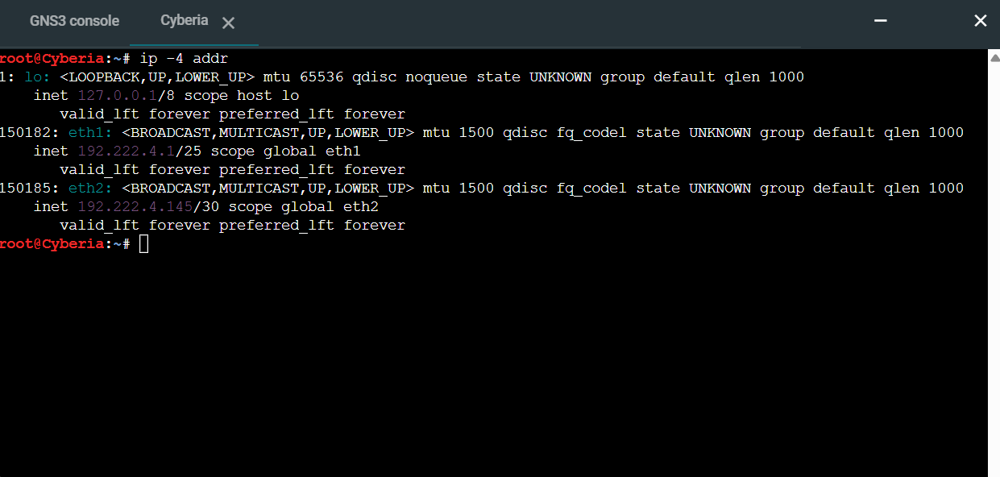

### 7.2. Tabel Routing Cyberia

Jalankan pada **console Cyberia (Debian)**:

``` bash
ip route
```

```
192.168.122.0/24 dev eth0 proto kernel scope link src <IP DHCP NAT>  (jaringan NAT)
192.222.4.0/25 dev eth1 proto kernel scope link src 192.222.4.1
192.222.4.144/30 dev eth2 proto kernel scope link src 192.222.4.145
192.222.0.0/19 via 192.222.4.146 dev eth2
default via 192.168.122.1 dev eth0 metric <angka>  (dari DHCP NAT)
```

Satu rute `192.222.0.0/19 via 192.222.4.146` sudah mencakup seluruh jaringan di belakang Wired.

**Gambar 7.2 --- Tabel routing Cyberia**

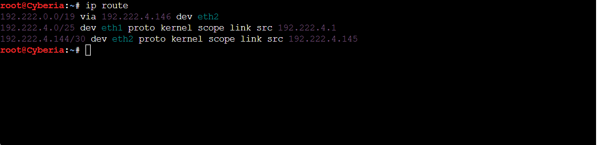

### 7.3. Tabel Routing Wired

Jalankan pada **console Wired (Debian)**:

``` bash
ip route
```

```
192.222.4.144/30 dev eth0 proto kernel scope link src 192.222.4.146
192.222.4.136/29 dev eth1 proto kernel scope link src 192.222.4.137
192.222.4.128/30 dev eth2 proto kernel scope link src 192.222.4.129
192.222.4.132/30 dev eth3 proto kernel scope link src 192.222.4.133
192.222.0.0/22 via 192.222.4.130 dev eth2
192.222.8.0/21 via 192.222.4.134 dev eth3
192.222.16.0/22 via 192.222.4.138 dev eth1
192.222.20.0/22 via 192.222.4.139 dev eth1
192.222.24.0/21 via 192.222.4.140 dev eth1
default via 192.222.4.145 dev eth0
```

Wired memiliki lima rute agregat, satu untuk setiap cabang di bawahnya (Navi, Tachibana, Psyche, Copland, Schumann).

**Gambar 7.3 --- Tabel routing Wired**

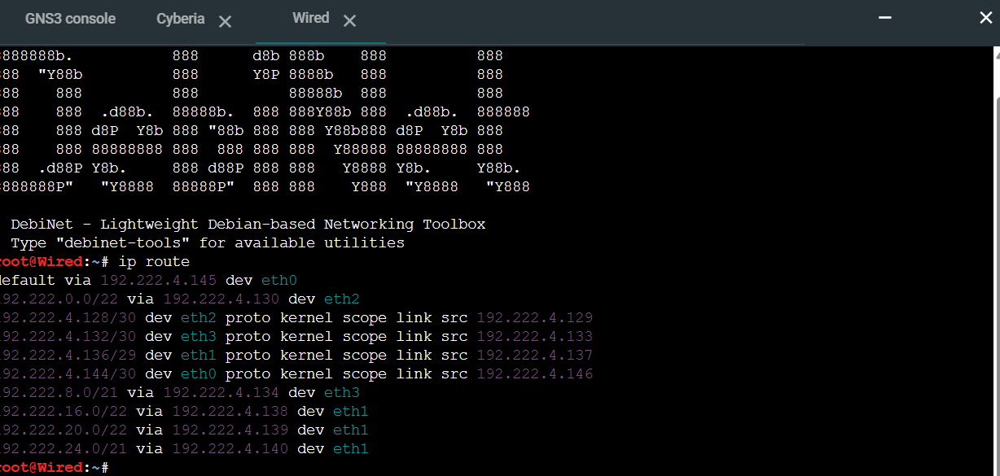

### 7.4. Tabel Routing Phantoma

Jalankan pada **console Phantoma (Debian)**:

``` bash
ip route
```

```
192.222.12.136/30 dev eth0 proto kernel scope link src 192.222.12.138
192.222.12.0/27 dev eth1 proto kernel scope link src 192.222.12.1
192.222.12.32/30 dev eth2 proto kernel scope link src 192.222.12.33
192.222.12.64/26 via 192.222.12.34 dev eth2
default via 192.222.12.137 dev eth0
```

Phantoma berada di lapisan dalam, sehingga hanya memiliki satu rute agregat ke Shibuya dan satu default route ke Knights.

**Gambar 7.4 --- Tabel routing Phantoma**

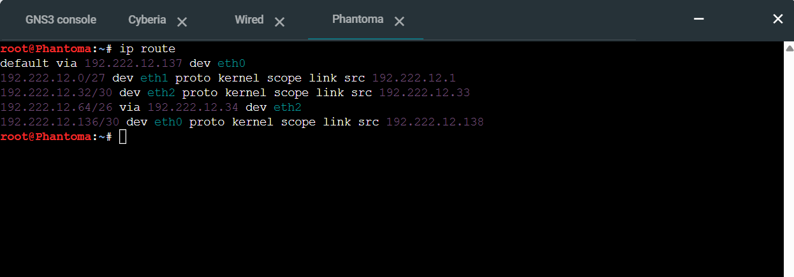

### 7.5. Konfigurasi Node Collective

Jalankan pada **console Collective (Debian)**:

``` bash
ip -4 addr
ip route
ping -c 3 192.222.8.1
```

**Gambar 7.5 --- Konfigurasi dan ping gateway pada Collective**

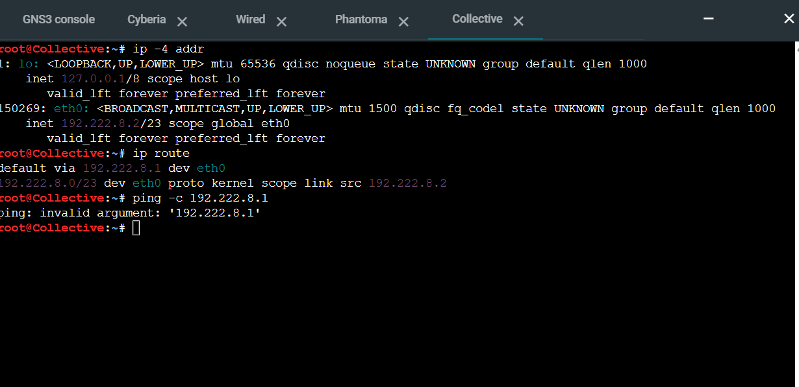

### 7.6. Ping ke Seluruh Alamat Topologi

Untuk membuktikan bahwa seluruh node dapat saling terhubung, kami menjalankan satu perintah yang melakukan ping ke seluruh **62 alamat** pada topologi (25 node dan 37 interface router) dari satu node sumber. Hasil akhirnya dirangkum dalam baris `OK=... FAIL=...`.

Perintah yang ditempel pada console node sumber:

``` bash
for t in 192.222.4.2:JJ 192.222.4.3:MyuMyu 192.222.16.2:Karl 192.222.16.3:Lin 192.222.22.2:Juri 192.222.20.2:Masayuki 192.222.28.2:Akashic 192.222.24.2:Omnipresence 192.222.24.3:Denpa 192.222.0.2:Alice 192.222.0.3:Reika 192.222.2.2:Taro 192.222.1.2:Yasuo 192.222.1.3:Miho 192.222.1.4:Kuma 192.222.8.2:Collective 192.222.8.3:Ghost 192.222.14.2:Lilith 192.222.14.3:Specter 192.222.13.2:Chisa 192.222.13.3:Hodgeson 192.222.12.130:Eiri 192.222.12.2:Semi 192.222.12.66:Lain 192.222.12.67:Mika 192.222.4.1:Cyberia.eth1 192.222.4.145:Cyberia.eth2 192.222.4.146:Wired.eth0 192.222.4.137:Wired.eth1 192.222.4.129:Wired.eth2 192.222.4.133:Wired.eth3 192.222.4.130:Navi.eth0 192.222.0.1:Navi.eth1 192.222.2.1:Navi.eth2 192.222.1.1:Navi.eth3 192.222.4.134:Tachibana.eth0 192.222.8.1:Tachibana.eth1 192.222.10.1:Tachibana.eth2 192.222.4.138:Psyche.eth0 192.222.16.1:Psyche.eth1 192.222.4.139:Copland.eth0 192.222.20.1:Copland.eth1 192.222.22.1:Copland.eth2 192.222.4.140:Schumann.eth0 192.222.28.9:Schumann.eth1 192.222.28.1:Schumann.eth2 192.222.28.10:Accela.eth0 192.222.24.1:Accela.eth1 192.222.10.2:Deus.eth0 192.222.14.1:Deus.eth1 192.222.14.129:Deus.eth2 192.222.14.130:Protocol7.eth0 192.222.13.1:Protocol7.eth1 192.222.13.65:Protocol7.eth2 192.222.13.66:Knights.eth0 192.222.12.129:Knights.eth1 192.222.12.137:Knights.eth2 192.222.12.138:Phantoma.eth0 192.222.12.1:Phantoma.eth1 192.222.12.33:Phantoma.eth2 192.222.12.34:Shibuya.eth0 192.222.12.65:Shibuya.eth1; do i=${t%%:*}; n=${t#*:}; if ping -c 1 -W 1 $i >/dev/null 2>&1; then echo "OK   $n ($i)"; else echo "FAIL $n ($i)"; fi; done | tee /tmp/hasil.txt; echo "OK=$(grep -c ^OK /tmp/hasil.txt) FAIL=$(grep -c ^FAIL /tmp/hasil.txt)"
```

Pengujian dilakukan dari empat node yang berada pada ujung cabang berbeda sehingga seluruh link dan rute agregat ikut terlewati:

| Node sumber | Cabang yang diuji | Hasil |
|---|---|---|
| Lain (A25) | rantai terdalam: Shibuya → Phantoma → Knights → Protocol7 → Deus → Tachibana → Wired | `OK=62 FAIL=0` |
| Taro (A13) | cabang Navi | `OK=62 FAIL=0` |
| Omnipresence (A11) | cabang Schumann → Accela | `OK=62 FAIL=0` |
| JJ (A1) | LAN Cyberia | `OK=62 FAIL=0` |

**Gambar 7.6 --- Ping ke 62 alamat dari Lain**

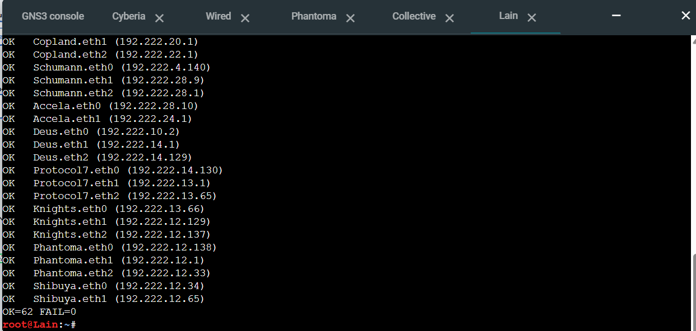

**Gambar 7.7 --- Ping ke 62 alamat dari Taro**

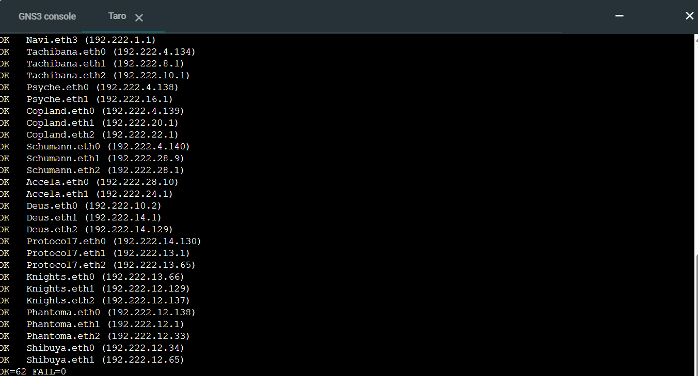

**Gambar 7.8 --- Ping ke 62 alamat dari Omnipresence**

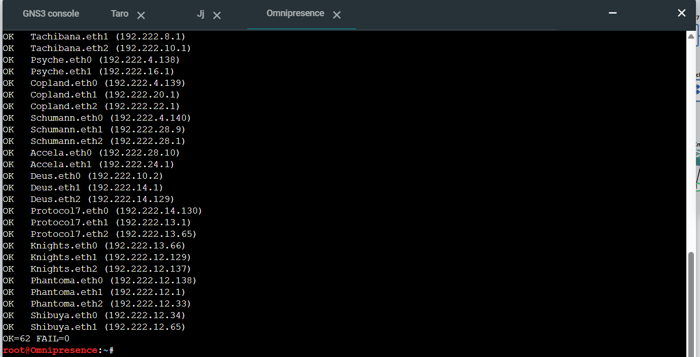

**Gambar 7.9 --- Ping ke 62 alamat dari JJ**

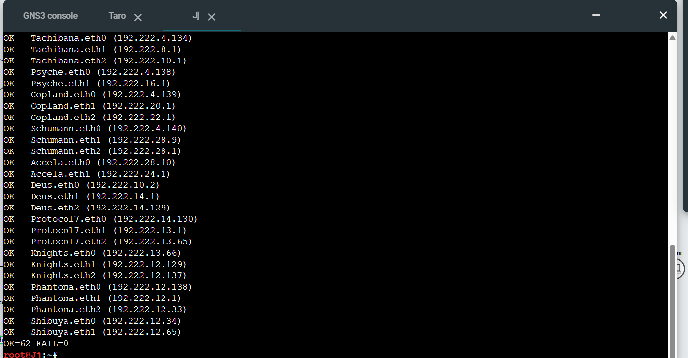

### 7.7. Jalur Paket dari Ujung ke Ujung (traceroute)

Pengujian ini memperlihatkan jalur paket dari node terdalam (Lain) menuju LAN Cyberia (JJ). Jalankan pada **console Lain (Debian)**:

``` bash
apt update && apt install -y traceroute
traceroute -n 192.222.4.2
```

Hasil yang diharapkan (alamat setiap hop adalah interface router yang dilalui):

| Hop | Alamat | Perangkat |
|---|---|---|
| 1 | 192.222.12.65 | Shibuya |
| 2 | 192.222.12.33 | Phantoma |
| 3 | 192.222.12.137 | Knights |
| 4 | 192.222.13.65 | Protocol7 |
| 5 | 192.222.14.129 | Deus |
| 6 | 192.222.10.1 | Tachibana |
| 7 | 192.222.4.133 | Wired |
| 8 | 192.222.4.145 | Cyberia |
| 9 | 192.222.4.2 | JJ (tujuan) |

**Gambar 7.10 --- Traceroute dari Lain ke JJ**

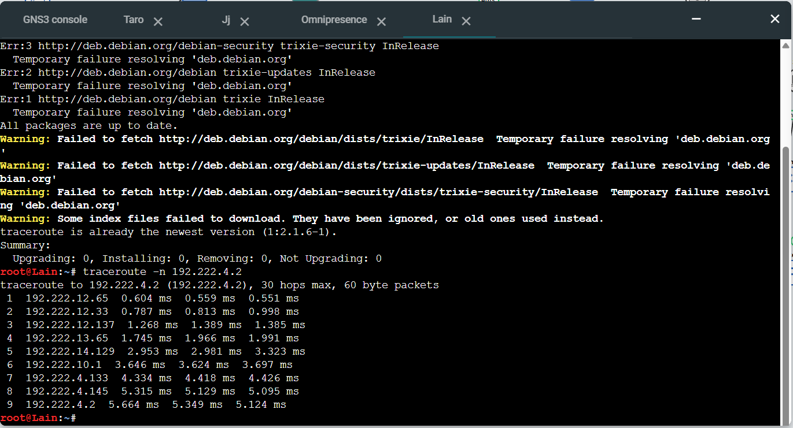

### 7.8. Pemilihan Rute Agregat

Perintah `ip route get` menunjukkan rute yang dipilih router untuk suatu tujuan. Alamat Mika (`192.222.12.67`) dipilih karena berada di lapisan terdalam:

| Router | Perintah | Hasil yang diharapkan |
|---|---|---|
| Cyberia | `ip route get 192.222.12.67` | `192.222.12.67 via 192.222.4.146 dev eth2 src 192.222.4.145` |
| Wired | `ip route get 192.222.12.67` | `192.222.12.67 via 192.222.4.134 dev eth3 src 192.222.4.133` |
| Tachibana | `ip route get 192.222.12.67` | `192.222.12.67 via 192.222.10.2 dev eth2 src 192.222.10.1` |
| Phantoma | `ip route get 192.222.12.67` | `192.222.12.67 via 192.222.12.34 dev eth2 src 192.222.12.33` |

Tujuan yang sama diteruskan melalui rute agregat yang semakin spesifik di setiap router, sampai tiba di Phantoma yang memiliki rute `192.222.12.64/26` menuju Shibuya.

**Gambar 7.11 --- Hasil ip route get pada beberapa router**


### 7.9. Akses Internet melalui NAT

``` bash
ping -c 3 8.8.8.8
```

**Gambar 7.12 --- Ping ke internet dari Lain**


------------------------------------------------------------------------